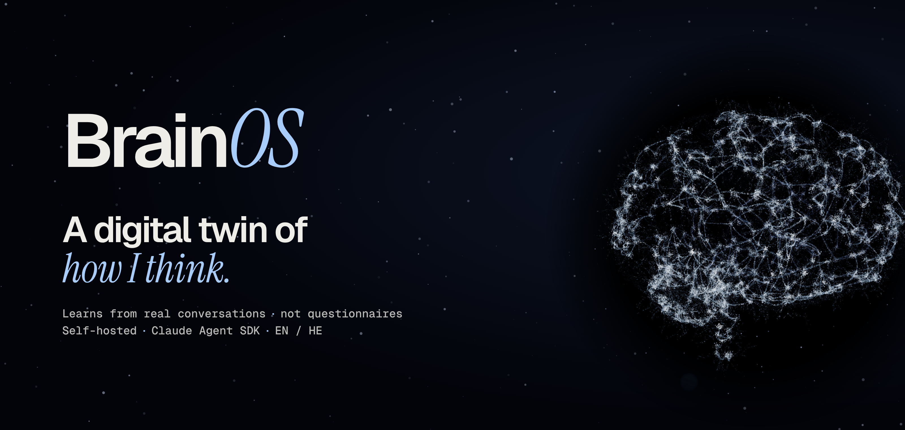
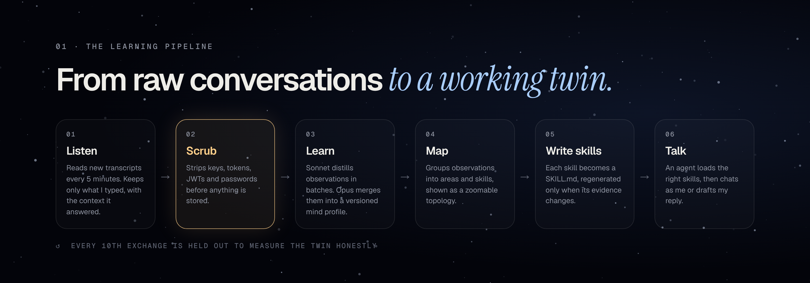
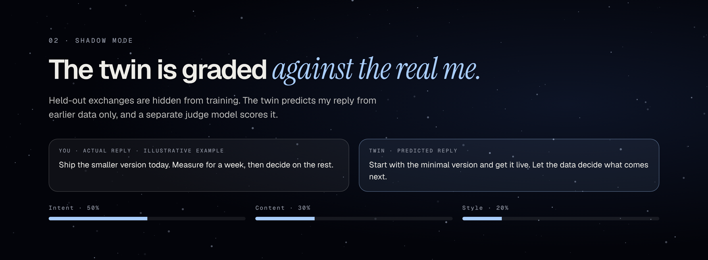
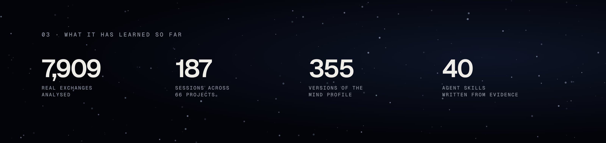

  

> **This is a showcase repository.** The source code is private. This page explains what BrainOS does and how it is built.

## What it is

BrainOS is a personal learning platform that builds a digital twin of how I think. It doesn't ask me to fill in questionnaires about myself. Instead, it reads my real conversations with Claude Code and learns from how I actually reason, decide and push back.

From that it builds a cognitive profile, a map of my skills, reusable agent skills, a growth plan and a coach. The twin can chat as me or draft the reply I would send.

## The learning pipeline

- **Listen.** New transcripts are read incrementally every 5 minutes. Only the messages I typed are kept, each paired with the message it answered.
- **Scrub.** API keys, tokens, JWTs, private keys and passwords are removed before anything is stored.
- **Learn.** Sonnet distills observations in batches. Opus merges them into a versioned mind profile.
- **Map.** Observations are grouped into areas and skills, shown as a zoomable topology.
- **Write skills.** Each skill becomes a `SKILL.md`, regenerated only when its evidence changes.
- **Talk.** An agent built on the Claude Agent SDK loads the relevant skills, then chats as me.

## Measured, not assumed

Every 10th exchange is held out from training. In shadow mode, the twin predicts those replies from earlier data only, and a separate judge model scores them on intent (50%), content (30%) and style (20%), with a one-line verdict.

The scores are still modest, and that is the point: the twin is measured against the real me, openly, so I know exactly how far to trust it.

## So far

## More than a twin

- **Today, Life and Trends.** A daily check-in, a life wheel and wellness tracking.
- **Mentor.** Commitments and regular reviews.
- **Growth.** An adaptive interview with reasoning puzzles, a development plan and a career path.
- **Evidence-backed advice.** Recommendations cite research studies through a read-only research connector.
- **Visual.** A 3D twin scene, a 3D brain and a live mind map, in English and Hebrew, with dark and light themes.

## At a glance

| | |
| --- | --- |
| **Stack** | TypeScript · Node · Hono · React 19 · Vite · three.js · SQLite (FTS5) |
| **AI** | Claude Agent SDK · Sonnet for distilling and judging · Opus for merging and for the twin |
| **Guardrails** | Secrets scrubbed before storage · tool-less model calls by default · the twin never learns from its own calls · automated transcripts can be excluded |
| **Hosting** | Self-hosted on a home server, behind Google sign-in with an allowlist |
| **Status** | In daily use and actively developed |

## About

BrainOS is my own project. I'm Igal Taflev, and I put AI to work and keep it accountable. More at [taflev.com](https://taflev.com) and on [LinkedIn](https://www.linkedin.com/in/igal-taflev).

Happy to walk through the pipeline and the agent setup in a conversation.

---

The example replies in the shadow-mode image are illustrative.
